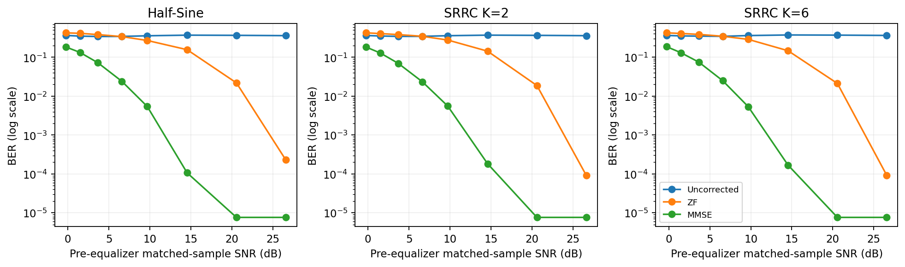
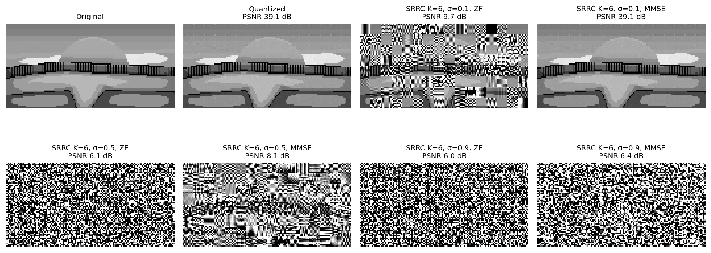

# Digital Image Transmission over Multipath Channels

Python simulation of a complete baseband image-communication chain developed for the Communication Systems course at Sharif University of Technology (Fall 2024).

**Author:** Farzan Aghaei

## System model

An 8 × 8 block DCT maps grayscale image coefficients to 8-bit integers. The resulting bitstream is transmitted using antipodal binary signaling and one of two unit-energy pulse shapes: Half-Sine or square-root raised-cosine (SRRC). The receiver models symbol-spaced multipath, additive Gaussian noise, time-reversed matched filtering, FFT-based Zero-Forcing (ZF) and regularized MMSE equalization, symbol detection, and inverse DCT reconstruction.

The experiments include transmit-pulse spectra and PSD, eye diagrams, matched-filter responses, equalizer spectra, BER, matched SNR and output SINR measurements, comparisons across three images, SRRC pulse spans, and three multipath channels.

## Selected results

For the original four-path channel, 65,536 transmitted bits, and pre-matched-filter noise standard deviation **σ = 0.5**:

| Pulse | ZF BER | MMSE BER |
|---|---:|---:|
| Half-Sine | 0.34042 | 0.02411 |
| SRRC (K = 6) | 0.34267 | 0.02466 |

These are measured simulation results for the specified random seed, channel, and receiver model, not analytical BER bounds. The notebook also reports reconstructed-image PSNR and matched-sample SNR.





## Run

Install dependencies with:

```bash
pip install -r requirements.txt
```

Open `Communication_Systems_Image_Transmission.ipynb` in Jupyter and run the cells in order from the repository root. The notebook reads grayscale inputs from `assets/`, saves figures in `figures/`, and exports numerical results to `results/`.

The model assumes that the receiver knows the channel, symbol timing, image dimensions, and global DCT quantization range. Equalization uses a finite circular-FFT approximation; ZF is numerically safeguarded, and the MMSE model approximates post-matched-filter noise as white. The three-image comparison additionally uses resized sample images from scikit-image.

The complete setup, numerical analysis, and interpretation are provided in [the technical report](Communication_Systems_Technical_Report.pdf).
